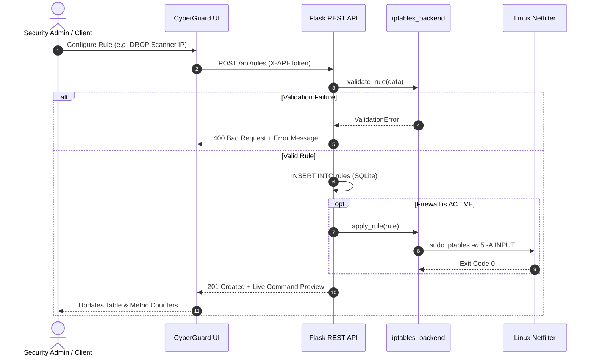

# 🛡️ CyberGuard: Web-Based Firewall Management & Packet Simulation Lab

<div align="center">


**An enterprise-grade, college-level cybersecurity dashboard and testing laboratory for Linux Netfilter (`iptables`).**

[](https://www.python.org/)
[](https://flask.palletsprojects.com/)
[](https://www.sqlite.org/)
[](https://netfilter.org/)
[](#-testing--automated-verification)
[](LICENSE)

[Key Features](#-key-features) • [Architecture](#-system-architecture) • [Quick Start](#-quick-start-guide) • [REST API](#-rest-api-reference) • [Live VM Deployment](#-live-linux-vm-deployment-phase-3) • [Packet Simulation](#-packet-simulation-engine) • [Presentation Guide](#-demonstration--presentation-script)

</div>

---

## 📖 Executive Overview

**CyberGuard** is a full-stack network security operations platform and interactive educational laboratory. It bridges the gap between high-level graphical management and low-level Linux kernel packet filtering.

CyberGuard provides:
1. **Visual Firewall Administration:** Real-time visualization and CRUD operations on the Linux `filter` table (`INPUT`, `OUTPUT`, and `FORWARD` chains).
2. **Deterministic Packet Simulation:** Safe, in-memory emulation of first-match kernel traversal logic with zero network risk.
3. **Ironclad Anti-Lockout Protection:** Enterprise safeguards including SSH lockout prevention, atomic baseline rule preservation, and a 60-second automatic kernel rollback watchdog.
4. **Dual Execution Engine:** Automatic safe fallback (`LAB_MODE` / `DRY_RUN`) on Windows/macOS, with full root-equivalent netfilter execution when deployed on Linux VMs.

---

## 🛡️ Key Features

### 1. 🎛️ Real-Time Cybersecurity Telemetry Dashboard
- **Live Status Beacon:** Glowing real-time indicators reflecting the exact state of kernel packet filtering (`ACTIVE` vs `DISABLED`).
- **Telemetry Metric Cards:** Real-time counters for active rules, blacklisted IP ranges, allowed network services, and packet throughput.
- **Kernel Policy Bar:** Visual indicators for default chain policies (`INPUT: DROP`, `OUTPUT: ACCEPT`, `FORWARD: DROP`).

### 2. ⚡ Dynamic Firewall Rules Management
- **Linux Filter Table Mirror:** Clean, tabular inspection of Rule IDs, Chains, Protocols, CIDR source/destination blocks, Port ranges, Actions (`ACCEPT`, `DROP`, `REJECT`), and live packet/byte hit counters.
- **Interactive Search & Multi-Criteria Filtering:** Instant client-side and server-side filtering by chain, action, IP, or port.
- **One-Click Simulator Prefill:** Jump directly from an active rule into the packet tester to verify enforcement behavior.

### 3. ✍️ Real-Time iptables Command Generator & Strict Validation
- **Live Netfilter Syntax Preview:** As you configure rule parameters, CyberGuard dynamically generates the exact shell command in real time:
  ```bash
  iptables -A INPUT -p tcp -s 192.168.1.50/32 --dport 22 -m comment --comment "cyberguard-101" -j ACCEPT
  ```
- **Strict Input Validation:** Enforces RFC-compliant IPv4 addressing, valid CIDR prefix bitmasks (`0–32`), valid port ranges (`1–65535`), and allowed protocol/chain enums.
- **Injection-Proof Execution:** All arguments are passed as discrete token arrays with `shell=False`, eliminating shell injection and command chaining risks.

### 4. 🔬 Zero-Risk Packet Simulation Engine
- **In-Memory Sequential Evaluation:** Accurately mimics Linux Netfilter's first-match traversal algorithm.
- **Granular Logic Traces:** Explains precisely why a packet was permitted, silently dropped, or rejected with TCP RST / ICMP unreachable responses.
- **Default Policy Fallback:** Transparently demonstrates chain default policies when no custom rules match.

### 5. 🧯 Enterprise Anti-Lockout Defense (Phase 3 Integration)
- **SSH Lockout Prevention (`LockoutRisk`):** Refuses to apply an `INPUT DROP` default policy unless an explicit rule allowing SSH (port 22) is configured.
- **Baseline Rule Preservation:** Automatically injects and guarantees loopback (`lo`) traffic and stateful connection tracking (`ESTABLISHED,RELATED`).
- **60-Second Auto-Rollback Watchdog:** Creates a snapshot with `iptables-save` prior to syncing. If the administrator fails to click **Confirm Rules** within 60 seconds, rules revert automatically via `iptables-restore`.

### 6. 📜 Activity Stream & Audit Export
- **Auditable Security Log:** Monospaced terminal recording every rule addition, deletion, simulation test, and policy modification.
- **One-Click Export:** Download full audit histories in structured JSON format for compliance and reporting.

---

## 🏛️ System Architecture

CyberGuard follows a clean 3-tier architecture with stateful database persistence and decoupled kernel synchronization:

```
+-------------------------------------------------------------------------+
|                  Modern Cyberpunk Web UI (Frontend)                    |
|       Vanilla JavaScript (ES6+) • Responsive CSS3 • Inter & JetBrains   |
+-------------------------------------------------------------------------+
                                    │
                         HTTP REST  │  JSON (X-API-Token)
                                    ▼
+-------------------------------------------------------------------------+
|                       Flask Application (app.py)                        |
|  - Token Authentication & Route Guards     - SQLite Connection Factory  |
|  - Request Sanitization & Schema Checks    - In-Memory Rule Evaluator   |
+-------------------------------------------------------------------------+
                    │                                     │
         Reads / Writes State                  Syncs Kernel Rules
                    ▼                                     ▼
+--------------------------------------+ +--------------------------------+
|       SQLite DB (firewall.db)        | |  iptables Backend Layer        |
|  - Table: rules (ordered by ID)      | |  - Argument-List Builder       |
|  - Table: logs (audit history)       | |  - Anti-Lockout Validator      |
|  - Table: settings (policies/state)  | |  - 60s Rollback Watchdog Timer |
+--------------------------------------+ +--------------------------------+
                                                          │
                                            Restricted sudo (/usr/sbin/...)
                                                          ▼
                                         +--------------------------------+
                                         |     Linux Kernel Netfilter     |
                                         |  - INPUT / OUTPUT / FORWARD    |
                                         |  - Packet & Byte Counters      |
                                         +--------------------------------+
```

### Packet Traversal Sequence



---

## 📁 Repository Structure

```
firewall-lab/
├── app.py                      # Flask REST API backend, routes, and auth
├── iptables_backend.py         # Subprocess iptables abstraction & anti-lockout guard
├── test_iptables_backend.py    # Unit tests for validation, safety, and counters
├── firewall.db                 # SQLite database (auto-generated with seed data)
├── requirements.txt            # Python package dependencies
├── index.html                  # Standalone browser entry point (Phase 1 demo)
├── templates/
│   └── index.html              # Jinja2 Flask template with session token injection
├── static/
│   ├── css/
│   │   └── style.css           # Custom dark cyberpunk stylesheet & animations
│   └── js/
│       └── app.js              # State manager, live command generator, & simulator
└── report_work/                # Academic report assets, diagrams, & build scripts
```

---

## 🚀 Quick Start Guide

### Prerequisites
- **Python:** Version 3.9 or higher
- **Browser:** Google Chrome, Microsoft Edge, Mozilla Firefox, or Safari
- **OS:** Windows, macOS, or Linux (Linux required for live kernel manipulation)

### 1. Installation

Clone or extract the repository, navigate into the directory, and set up a virtual environment:

```bash
cd firewall-lab

# Optional: Create and activate a virtual environment
python -m venv venv
# On Windows:
.\venv\Scripts\activate
# On Linux/macOS:
source venv/bin/activate

# Install required dependencies
python -m pip install -r requirements.txt
```

### 2. Running in Safe Mode (Default / Laptop Run)

By default, `LAB_MODE` and `DRY_RUN` are enabled. Commands are validated, command previews are dynamically generated, and the database updates, but **no real iptables modifications occur**:

```bash
python app.py
```

Open your browser and navigate to:
```
http://127.0.0.1:5000
```

> [!NOTE]
> When running on non-Linux platforms (e.g. Windows), CyberGuard automatically locks execution into **Safe Lab Mode** and displays a badge in the sidebar.

---

## 🐧 Live Linux VM Deployment (Phase 3)

Follow these steps to run CyberGuard on a live Linux server (Ubuntu 22.04 / 24.04 recommended) with real kernel enforcement.

### Step 1: VM Preparation & Dependencies
```bash
sudo apt update
sudo apt install -y python3 python3-pip iptables

# Verify binary locations
which iptables iptables-save iptables-restore
```

### Step 2: Configure Least-Privilege Sudoers
To avoid running Flask as `root`, grant the application user restricted access to **only** the required `iptables` binaries:

```bash
sudo visudo -f /etc/sudoers.d/cyberguard
```

Add the following single line (replace `<your-username>` with your actual Linux user):
```sudoers
<your-username> ALL=(root) NOPASSWD: /usr/sbin/iptables, /usr/sbin/iptables-save, /usr/sbin/iptables-restore
```

### Step 3: Launch with Live Kernel Privileges
Set a custom API token and disable safe-mode flags:

```bash
LAB_MODE=False DRY_RUN=False CYBERGUARD_TOKEN='super-secret-key-12345' python3 app.py
```

### Step 4: Access via Secure SSH Tunnel
Because CyberGuard binds strictly to `127.0.0.1` for security, establish an SSH tunnel from your host workstation:

```bash
ssh -L 5000:127.0.0.1:5000 <your-username>@<vm-ip-address>
```
Then access the interface at `http://127.0.0.1:5000` on your host workstation.

> [!WARNING]
> Never bind CyberGuard directly to `0.0.0.0` or expose it to public networks without HTTPS and network-level access controls.

---

## 🔌 REST API Reference

All write endpoints (`POST`, `DELETE`) require the authentication header:
`X-API-Token: <CYBERGUARD_TOKEN>` (automatically provided by the frontend).

| Method | Endpoint | Description | Auth Required |
|:---:|:---|:---|:---:|
| `GET` | `/api/health` | Backend health, mode flags (`lab_mode`, `dry_run`), & DB path | No |
| `GET` | `/api/rules` | Fetch all firewall rules from SQLite (ordered by ID) | No |
| `POST` | `/api/rules` | Add, validate, and apply a new firewall rule | **Yes** |
| `DELETE` | `/api/rules/<id>` | Remove a firewall rule by numeric ID | **Yes** |
| `GET` | `/api/firewall/status` | Current firewall state, default policies, & rollback info | No |
| `POST` | `/api/firewall/toggle` | Enable or disable kernel packet filtering | **Yes** |
| `POST` | `/api/firewall/confirm` | Confirm newly applied rules and cancel rollback timer | **Yes** |
| `POST` | `/api/simulate` | Evaluate a packet against the active rule hierarchy | **Yes** |
| `GET` | `/api/live/counters` | Real-time packet/byte counters parsed from `iptables -L` | No |
| `GET` | `/api/logs` | Retrieve recent audit logs (supports `?limit=100`) | No |
| `DELETE` | `/api/logs` | Clear all activity and audit records | **Yes** |
| `GET` | `/api/logs/export` | Download audit history as a formatted `.json` file | No |

<details>
<summary><b>🔍 Sample Request & Response Payloads</b></summary>

#### Add Rule Payload (`POST /api/rules`)
```json
{
  "chain": "INPUT",
  "protocol": "TCP",
  "src_ip": "198.51.100.45",
  "dst_ip": "0.0.0.0/0",
  "src_port": "any",
  "dst_port": "80",
  "action": "DROP"
}
```

#### Simulation Request (`POST /api/simulate`)
```json
{
  "chain": "INPUT",
  "protocol": "TCP",
  "src_ip": "198.51.100.45",
  "dst_ip": "192.168.1.10",
  "dst_port": "80"
}
```

#### Simulation Response (`200 OK`)
```json
{
  "success": true,
  "verdict": "BLOCK",
  "explanation": "Packet DROPPED - matched Rule #105 (INPUT TCP from 198.51.100.45/32). Silently discarded, no response sent.",
  "matched_rule": {
    "id": 105,
    "chain": "INPUT",
    "protocol": "TCP",
    "src_ip": "198.51.100.45",
    "dst_port": "80",
    "action": "DROP"
  }
}
```
</details>

---

## 🧪 Testing & Automated Verification

CyberGuard includes automated unit tests covering input sanitation, shell-injection resistance, anti-lockout logic, and counter parsing.

Run the test suite on any platform (completely safe; dry-run mode prevents firewall modification):

```bash
python -m unittest test_iptables_backend -v
```

### Test Suite Coverage:
- `test_valid_rule_builds_expected_command`: Ensures valid rule dictionaries compile into accurate `iptables` argument lists.
- `test_injection_attempts_rejected`: Verifies rejection of command injection attempts (`rm -rf`, `;`, `&&`, malformed IPs, out-of-range ports).
- `test_any_means_no_filter`: Ensures wildcards (`0.0.0.0/0`, `any`) omit redundant filter flags.
- `test_dry_run_never_executes`: Proves no subprocess runs when `DRY_RUN=True`.
- `test_lockout_blocked_without_ssh_rule`: Asserts `LockoutRisk` exception is raised when applying `INPUT DROP` without SSH access.
- `test_sync_orders_policies_last`: Verifies that default drop policies are applied **after** rules are populated to prevent mid-sync lockouts.
- `test_counter_parsing`: Tests regex parsing of `iptables -L -v -n -x` output.

---

## 🌐 Network Lab Topology

For comprehensive lab testing and presentation demonstrations, a multi-VM host-only network configuration is recommended:

```
                  +----------------------------------------+
                  |         Host-Only Virtual Network      |
                  |             192.168.56.0 / 24          |
                  +----------------------------------------+
                                       |
          ┌────────────────────────────┼────────────────────────────┐
          ▼                            ▼                            ▼
+--------------------+       +--------------------+       +--------------------+
|  VM 1: Firewall    |       |  VM 2: Test Client |       |  VM 3: Web Server  |
|  IP: 192.168.56.10 |       |  IP: 192.168.56.20 |       |  IP: 192.168.56.30 |
|  - CyberGuard App  |       |  - Traffic Source  |       |  - Nginx / Apache  |
|  - Netfilter Core  |       |  - curl / hping3   |       |  - Target Service  |
+--------------------+       +--------------------+       +--------------------+
```

---

## 🎯 Demonstration & Presentation Script

Follow this structured 5-minute walkthrough during academic project reviews:

1. **Dashboard Overview (1 min):**
   - Highlight the dark cyberpunk theme, live glowing status beacon, and default chain policies (`INPUT: DROP`, `OUTPUT: ACCEPT`, `FORWARD: DROP`).
   - Show the telemetry cards reflecting active rules and blocked sources.
2. **Rule Configuration & Live Preview (1.5 min):**
   - Click **Add Rule** and enter:
     - Chain: `INPUT` | Protocol: `TCP` | Source: `198.51.100.45` | Port: `80` | Action: `DROP`.
   - Point out the **Live Command Preview** updating in real time with comment metadata (`cyberguard-id`).
   - Submit and show the rule appearing in the active rules table with updated badge counters.
3. **Packet Simulation Engine (1.5 min):**
   - Navigate to **Packet Tester**.
   - Inject a packet from `198.51.100.45` to `192.168.1.10:80` → Verdict displays glowing **BLOCK** with rule resolution details.
   - Change Source IP to a trusted host (`192.168.1.50`) → Verdict shifts to **ALLOW**.
   - Test an unconfigured port (`8080`) → Demonstrates fallthrough to the chain's default policy (`DROP`).
4. **Safety Mechanisms & Audit Trail (1 min):**
   - Navigate to **Activity Log** to display the audit stream capturing timestamps, actions, and simulation outcomes.
   - Click **Export JSON** to show compliance logging capability.
   - Highlight the **60-Second Auto-Rollback** mechanism and anti-lockout validation preventing accidental isolation of remote admins.

---

## 🔒 Security Best Practices Implemented

- **Safe Subprocess Invocations:** No instances of `shell=True`; all system commands are executed via strict argument vectors.
- **Strict Network Validation:** Comprehensive regex and `ipaddress` parsing prevents malformed parameters and injection attacks.
- **Least-Privilege Operation:** The web application runs as an unprivileged user, accessing `iptables` exclusively via targeted `sudoers` grants.
- **Loopback Binding:** Flask is bound to `127.0.0.1` by default to prevent unauthorized network exposure.
- **Stateless API Guarding:** Non-idempotent operations require `X-API-Token` validation.

---

## 📄 License

This project is open-source software licensed under the [MIT License](LICENSE).
Developed for academic cybersecurity research and educational laboratory instruction.
